---

```
⡏⠉⠉⠉⠉⠉⠉⠋⠉⠉⠉⠉⠉⠉⠋⠉⠉⠉⠉⠉⠉⠉⠉⠉⠉⠙⠉⠉⠉⠹
⡇⢸⣿⡟⠛⢿⣷⠀⢸⣿⡟⠛⢿⣷⡄⢸⣿⡇⠀⢸⣿⡇⢸⣿⡇⠀⢸⣿⡇⠀
⡇⢸⣿⣧⣤⣾⠿⠀⢸⣿⣇⣀⣸⡿⠃⢸⣿⡇⠀⢸⣿⡇⢸⣿⣇⣀⣸⣿⡇⠀
⡇⢸⣿⡏⠉⢹⣿⡆⢸⣿⡟⠛⢻⣷⡄⢸⣿⡇⠀⢸⣿⡇⢸⣿⡏⠉⢹⣿⡇⠀
⡇⢸⣿⣧⣤⣼⡿⠃⢸⣿⡇⠀⢸⣿⡇⠸⣿⣧⣤⣼⡿⠁⢸⣿⡇⠀⢸⣿⡇⠀
⣇⣀⣀⣀⣀⣀⣀⣄⣀⣀⣀⣀⣀⣀⣀⣠⣀⡈⠉⣁⣀⣄⣀⣀⣀⣠⣀⣀⣀⣰
⣇⣿⠘⣿⣿⣿⡿⡿⣟⣟⢟⢟⢝⠵⡝⣿⡿⢂⣼⣿⣷⣌⠩⡫⡻⣝⠹⢿⣿⣷
⡆⣿⣆⠱⣝⡵⣝⢅⠙⣿⢕⢕⢕⢕⢝⣥⢒⠅⣿⣿⣿⡿⣳⣌⠪⡪⣡⢑⢝⣇
⡆⣿⣿⣦⠹⣳⣳⣕⢅⠈⢗⢕⢕⢕⢕⢕⢈⢆⠟⠋⠉⠁⠉⠉⠁⠈⠼⢐⢕⢽
⡗⢰⣶⣶⣦⣝⢝⢕⢕⠅⡆⢕⢕⢕⢕⢕⣴⠏⣠⡶⠛⡉⡉⡛⢶⣦⡀⠐⣕⢕
⡝⡄⢻⢟⣿⣿⣷⣕⣕⣅⣿⣔⣕⣵⣵⣿⣿⢠⣿⢠⣮⡈⣌⠨⠅⠹⣷⡀⢱⢕
⡝⡵⠟⠈⢀⣀⣀⡀⠉⢿⣿⣿⣿⣿⣿⣿⣿⣼⣿⢈⡋⠴⢿⡟⣡⡇⣿⡇⡀⢕
⡝⠁⣠⣾⠟⡉⡉⡉⠻⣦⣻⣿⣿⣿⣿⣿⣿⣿⣿⣧⠸⣿⣦⣥⣿⡇⡿⣰⢗⢄
⠁⢰⣿⡏⣴⣌⠈⣌⠡⠈⢻⣿⣿⣿⣿⣿⣿⣿⣿⣿⣿⣬⣉⣉⣁⣄⢖⢕⢕⢕
⡀⢻⣿⡇⢙⠁⠴⢿⡟⣡⡆⣿⣿⣿⣿⣿⣿⣿⣿⣿⣿⣿⣿⣿⣿⣿⣷⣵⣵⣿
⡻⣄⣻⣿⣌⠘⢿⣷⣥⣿⠇⣿⣿⣿⣿⣿⣿⠛⠻⣿⣿⣿⣿⣿⣿⣿⣿⣿⣿⣿
⣷⢄⠻⣿⣟⠿⠦⠍⠉⣡⣾⣿⣿⣿⣿⣿⣿⢸⣿⣦⠙⣿⣿⣿⣿⣿⣿⣿⣿⠟
⡕⡑⣑⣈⣻⢗⢟⢞⢝⣻⣿⣿⣿⣿⣿⣿⣿⠸⣿⠿⠃⣿⣿⣿⣿⣿⣿⡿⠁⣠
⡝⡵⡈⢟⢕⢕⢕⢕⣵⣿⣿⣿⣿⣿⣿⣿⣿⣿⣶⣶⣿⣿⣿⣿⣿⠿⠋⣀⣈⠙
⡝⡵⡕⡀⠑⠳⠿⣿⣿⣿⣿⣿⣿⣿⣿⣿⣿⣿⣿⣿⣿⠿⠛⢉⡠⡲⡫⡪⡪⡣
```

---

> [!IMPORTANT]
> 
